<div align="center">

</div>

<p align="center">
<a href="README.md"></a>
&nbsp;
<a href="README.zh-CN.md"></a>
</p>

Most agent instructions are homework for the model. Be brief. Be careful. Ask before acting. Spend as little as possible.

`modus-max` moves in the other direction, and it only loads when you ask for it by name. The agent is told, in writing, that steps, tokens, branches and subagents are not the constraint. The result is.

## What it does

Four things change once the skill is loaded.

- **The budget stops being an argument.** No cap on tool calls, verification rounds, exploration branches, or the number of subagents. Parallel, chained, recursive: all fair.
- **The route gets chosen, not stumbled into.** When two paths reach the goal, the agent takes the better one, not the first one that happens to run.
- **The agent stops asking you to decide its engineering.** Naming, tooling, wiring, retries: its problem. It asks only when a decision would change the shape or scope of what you get, or move your intent. When it does ask, it brings the candidates.
- **The delivery bar moves up.** "Passes" is not the target. "Worth showing" is.

## Before and after

| | Ordinary session | With `modus-max` |
|---|---|---|
| Steps and tool calls | kept lean | uncapped |
| Routes tried | first that works | best that exists |
| Subagents | used when unavoidable | as many as the work earns |
| Questions back to you | early and often | only when the delivery changes shape |
| Shared test or render environments | whoever gets there first | one entry point, queued |
| Definition of done | it passes | it is worth showing |

## Install

```bash
npx skills add Xuehua-Meaw/modus-max --skill modus-max
```

Node 22.20 or later. The CLI installs into `.agents/skills/modus-max` and links it for every agent it finds. Add `-g` to install for all projects instead of the current one.

## Invoke

Say it in the chat:

```
read modus_max
```

`/modus-max` works too. The mode holds for the rest of the session; it survives task switches and other skills loading on top. It stops when you say stop. Any subagent the agent dispatches is told to read the skill first.

## The gate

The skill loads on direct mention, and on nothing else. Asking for more thoroughness, more creativity, or more effort does not trigger it, and the agent will not switch modes behind your back.

That gate is the point. A mode with no ceiling is useful in the moments you choose it and expensive everywhere else.

## Files

| File | Language |
|---|---|
| [`SKILL.md`](SKILL.md) | English |
| [`SKILL.zh-CN.md`](SKILL.zh-CN.md) | Simplified Chinese |

Both carry the same rules, the same eight-point execution standard, and the same dispatch fragment. The English file is the one the CLI reads.

## Compatibility

Any agent the [skills CLI](https://github.com/vercel-labs/skills) supports. At the last count that was 79 of them, from Claude Code and Codex to Cursor, Copilot, Gemini CLI and Kimi.

<div align="center">

---

<sub><code>overcharge yourself</code></sub>

</div>
