<div align="center">

</div>

<p align="center">
<a href="README.md"></a>
&nbsp;
<a href="README.zh-CN.md"></a>
</p>

大多数给智能体的指令，本质上是布置给模型的作业：简短一点，谨慎一点，动手之前先问，成本压到最低。

`modus-max` 走反方向，而且只在你亲自点名时才加载。它把一句话写进智能体的上下文：步骤、Token、分支、子代理都不是约束，结果才是。

## 它改了什么

加载之后，四件事会变。

- **预算不再是讨论对象。** 工具调用、验证轮次、探索分支、子代理数量，全部不设上限。并行、串联、递归都可以。
- **路线是被选出来的，不是撞出来的。** 两条路都能到终点时，选更好的那条，不是先跑通的那条。
- **工程细节不再丢回给你。** 命名、选型、接线、重试，都是它自己的事。只有会改变交付形态或范围、或者动摇你意图的决定，才会拿来问你；真要问，一次问完，候选方案一并给出。
- **交付线往上抬。** 目标不是「能过」，是「值得展示」。

## 加载前后

| | 普通会话 | 加载 `modus-max` 之后 |
|---|---|---|
| 步骤与工具调用 | 能省则省 | 不设上限 |
| 尝试的路线 | 先跑通的那条 | 能做到最好的那条 |
| 子代理 | 非用不可才用 | 工作量能撑起多少就派多少 |
| 回头问你 | 越早问越保险 | 只在交付形态改变时问 |
| 共用的测试、渲染环境 | 谁先到谁用 | 统一入口排队 |
| 完成标准 | 能过 | 值得展示 |

## 安装

```bash
npx skills add Xuehua-Meaw/modus-max --skill modus-max
```

需要 Node 22.20 或更高版本。CLI 会把技能装进 `.agents/skills/modus-max`，并为它探测到的每个智能体挂上链接。加 `-g` 则装到全局，而不是当前项目。

## 调用

在对话里直接说：

```
read modus_max
```

写 `/modus-max` 也行。模式在本次会话内持续有效，任务切换、加载别的技能都不会让它失效或叠加；你说停，它就停。它派出去的每个子代理，都会被要求先读这份技能。

## 这道闸门

技能只在被直接点名时加载，其他情况一律不加载。你说「做得更彻底一点」「多花点步骤」，它不会因此被触发，也不会背着你切换模式。

闸门本身就是重点。一个没有天花板的模式，在你自己选中的那一刻有用，在别的地方都很贵。

## 文件

| 文件 | 语言 |
|---|---|
| [`SKILL.md`](SKILL.md) | 英文 |
| [`SKILL.zh-CN.md`](SKILL.zh-CN.md) | 简体中文 |

两份规则完全一致，八条执行标准、派遣片段都一样。CLI 读取的是英文那份。

## 兼容性

[skills CLI](https://github.com/vercel-labs/skills) 支持的所有智能体都能用。最近一次统计是 79 个，包括 Claude Code、Codex、Cursor、Copilot、Gemini CLI、Kimi。

<div align="center">

---

<sub><code>把自己加压到极限</code></sub>

</div>
